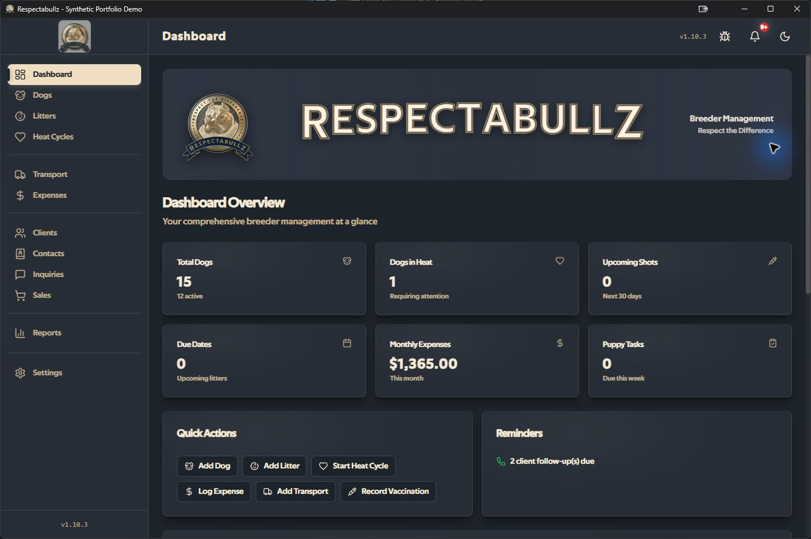
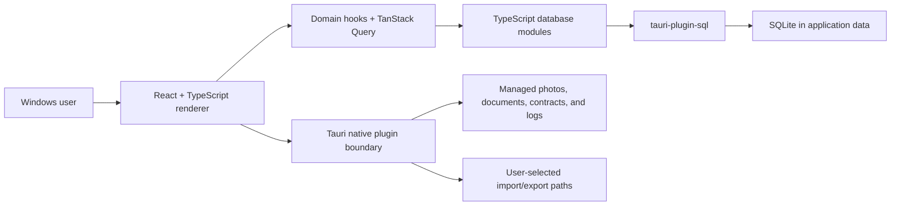

# Respectabullz

**A local-first Windows desktop application for dog-breeding operations.**

Respectabullz brings animal and litter records, health workflows, inquiries, sales,
documents, photos, expenses, and follow-up work into one desktop application. It is
built with React, TypeScript, Tauri 2, and SQLite through `tauri-plugin-sql`.

> **Portfolio-remediation status (2026-07-14):** this source is being prepared as an
> inspectable product-engineering case study. It is not represented as production
> proven, independently security assessed, or ready for recovery-dependent use. The
> historical restore path is withdrawn, and the existing export formats are partial
> data exports—not verified backups. See [Current safety status](#current-safety-status).

[Case study](docs/case-study/CASE_STUDY.md) ·
[Employer deck](docs/case-study/Respectabullz_Employer_Case_Study.pptx) ·
[Synthetic customer packet](docs/case-study/synthetic-customer-packet.pdf) ·
[Architecture](docs/ARCHITECTURE.md) ·
[Reliability](docs/RELIABILITY.md) ·
[Test evidence](docs/case-study/TEST_EVIDENCE.md) ·
[Security](SECURITY.md) ·
[Privacy](PRIVACY.md)

Source version: **1.10.3**



*Live Windows/Tauri capture from the isolated `com.respectabullz.demo` profile using
deterministic synthetic records. It is not customer or production data.*

## The operational problem

Breeder operations often span disconnected spreadsheets, paper health records,
photos, contracts, messages, and reminders. Respectabullz explores how one local
system can:

- connect related records instead of maintaining isolated forms;
- turn operational state into visible tasks and follow-up work; and
- generate familiar local documents and exports from structured records.

The intended user is a single operator on Windows. The repository does not claim
measured customer adoption.

## Workflow groups

- **Animal and litter records:** identity, status, pedigree, genetics, breeding,
  births, and placement.
- **Health operations:** vaccinations, medications, weights, appointments, and
  medical records.
- **Client and sales pipeline:** inquiries, waitlist, contacts, deposits, sales,
  delivery, and transport.
- **Documents and communication:** contracts, customer packets, uploaded files,
  templates, and communication history.
- **Operations and reporting:** tasks, expenses, dashboard summaries, and local
  spreadsheet/PDF exports.

These groups describe product scope, not a guarantee that every path has equivalent
test coverage or failure recovery. The dated evidence is in
[`TEST_EVIDENCE.md`](docs/case-study/TEST_EVIDENCE.md).

## Architecture at a glance



Most domain and UI logic lives in TypeScript. The Rust crate hosts Tauri and now owns
the integrity-sensitive database setup/migration, managed-document, and fixed external
support-link boundaries; it is not a separate service. Prisma files are
schema/reference tooling and are not the runtime ORM. See
[Architecture](docs/ARCHITECTURE.md) for data flow and trust boundaries.

## Engineering decisions and tradeoffs

| Constraint | Current decision | Benefit | Explicit tradeoff |
| --- | --- | --- | --- |
| Sensitive operational records | Local SQLite storage | Offline operation and direct user control | No built-in multi-device sync, centralized recovery, or multi-user authorization |
| Document-heavy Windows workflow | Tauri file/dialog integrations | Familiar local files and native dialogs | Filesystem permissions and partial-failure handling require careful design |
| Responsive edits | TanStack Query and optimistic updates | Fast interaction | Each mutation needs its own rollback and stale-state verification |
| Mixed database and file state | Keep paths in SQLite and files in application data | Avoids storing large binaries in SQLite | Database and filesystem changes are not one transaction |
| Recovery | Withdraw incomplete restore until a versioned format passes failure tests | Avoids presenting partial mutation as successful recovery | No supported in-app restore today |
| AI-assisted development | Use AI for drafts and exploration with human review | Faster iteration | Ownership must be demonstrated with reproducible evidence and live understanding |

## Current safety status

### Restore and exports

- **Restore is not a supported capability.** Any legacy build that still displays a
  restore control must not be used for recovery.
- Current JSON and ZIP exports cover only subsets of application state. They are
  convenience exports, not complete or verified backups.
- The partial ZIP writes directly to the exact file selected in the native save dialog;
  it is non-atomic, so interruption can leave an incomplete target.
- The ZIP export aborts before destination selection if managed photos cannot be
  enumerated or read; it does not silently omit those files and report success.
- A future recovery format is specified as a proposal in
  [`BACKUP_FORMAT.md`](docs/BACKUP_FORMAT.md). It is not implemented.

### Clear/reset and test data

- There is no verified in-app factory reset.
- The production UI removes **Clear All Data**, **Remove Test Data**, and the former
  first-launch sample-data choice. First launch offers only **Start Fresh** with an
  empty database. A separate debug-only seed path is visible and callable only under
  the exact isolated `com.respectabullz.demo` identity; it refuses to run when any
  user-created application record exists instead of clearing existing data.
  Fresh-schema predefined tags/categories are the only permitted rows. Older builds
  that expose the former destructive controls are unsupported.
- The former automatic import from the `respectabullz_db` browser-storage key is
  withdrawn because its multi-table writes were not atomic. If that key is detected,
  startup stops before SQLite setup and leaves the browser payload unchanged; preserve
  the profile for a future transactional recovery workflow.
- Deleting application data cannot recall copies previously exported to other
  folders, cloud drives, email, or removable media.

### Bug reporting

- Do **not** configure `VITE_GITHUB_TOKEN`. A repository credential must never be
  bundled into renderer code or a Vite build.
- The remediation flow prepares and sanitizes a complete preview locally, warns that
  public GitHub issues are public, and only after an explicit click copies the reviewed
  draft and opens the fixed blank GitHub Issues/new page. Report data is kept out of
  the URL. It uses no application credential and does not attach logs, records,
  photos, or documents automatically; the user pastes and submits the report.
- Central logging and the report draft redact common credential, contact, path, UUID,
  and sensitive context-key patterns and truncate long values. These rules are
  defense in depth, not a guarantee that semantic personal information is recognized.
  Remove any remaining sensitive details before submitting.
- Log clear/export operations serialize with pending disk writes so they do not race
  the current write queue; this is an ordering control, not a semantic-privacy proof.
- Security vulnerabilities must be reported privately as described in
  [SECURITY.md](SECURITY.md), not in a public issue.

## Quality evidence

The reviewed baseline commit predated repository CI. The remediation tree now defines
a required GitHub Actions workflow with frontend checks, Windows Rust/Tauri build and
packaged startup smoke on an ephemeral hosted runner, secret-history scanning, npm/Rust
dependency evidence, npm CycloneDX SBOM and installer artifacts, checksums, plus weekly
Dependabot review. There is not yet a successful public run URL for a frozen final commit. The following is the
dated local baseline for commit
`fd21363beae044f0649a1e03f3bb6bcc2249f970`, not an assertion about future commits:

- ESLint: passed.
- TypeScript no-emit check: passed.
- Vitest: 290 tests in 15 files passed.
- Overall statement/line coverage: 10.93%; several critical migration and document
  paths had 0% coverage.
- Dependency scanning reported unresolved advisories.
- No Windows installer smoke test, checksum, SBOM, signing verification, or required
  public CI evidence was established by that baseline.

The later remediation tree was installed with pinned Node 22.23.1/npm 10.9.8. The
latest local pre-release checkpoint passed 354 frontend tests in 39
files and 39 Rust tests. The exact tree also passed lint/type/version/
demo guards, web and NSIS builds, artifact scans, production audit, source/history
secret scans, workflow lint, and npm SBOM generation. Production npm audit reported 0
findings; the informative full graph retained 7. A native smoke exposed a Tokio
nested-runtime startup panic. After correction, a rebuilt executable remained alive for
eight seconds with empty stderr. That local launch was not isolated: Windows/Tauri ignored
process-level `APPDATA` overrides and opened the real profile's SQLite sidecars while the
main database file remained unchanged. The exact final-SHA smoke is therefore delegated to
the ephemeral CI runner. None of this is public CI or release evidence. The latest
frontend coverage checkpoint reported 22.21% statements/lines, 62.73% branches, and
27.85% functions.

Commands, dates, scope, and missing gates are recorded in
[`TEST_EVIDENCE.md`](docs/case-study/TEST_EVIDENCE.md). A raw test count is not used
as a reliability claim.

## Security and privacy model

Core records and managed files are stored locally. That boundary has important
limits:

- the SQLite database, managed files, logs, and current exports are plaintext unless
  the user applies operating-system or storage encryption;
- user-selected exports leave application lifecycle control;
- local logging can still contain error details or semantic context not recognized by
  the implemented redaction rules;
- Tauri capabilities and the CSP reduce some exposure but are not a security audit;
  `http://asset.localhost` is allowed for Tauri `convertFileSrc` image URLs while
  connection sources remain self-only;
- Rust preloads the single supported SQLite pool, and the renderer cannot load or
  close alternate pools. It still has select/execute authority against the application
  database, so this is pool-lifecycle containment rather than a query sandbox;
- unsigned Windows builds can trigger SmartScreen and do not prove publisher
  identity; and
- dependency advisories and permission scope require continuing review.

Read [PRIVACY.md](PRIVACY.md), [SECURITY.md](SECURITY.md), and
[`THREAT_MODEL.md`](docs/THREAT_MODEL.md) before using real records.

## Run from source

### Requirements

- Windows 10 or later
- Node.js 22.x and npm 10.x (`.nvmrc` pins the local/CI Node release)
- Rust stable toolchain
- Microsoft C++ Build Tools and WebView2 prerequisites required by Tauri

### Development

```powershell
git clone https://github.com/LeftHandVoodoo/Respectabullz.git
Set-Location .\Respectabullz
npm ci
npm run tauri:dev
```

The Vite-only command (`npm run dev`) can render frontend code but cannot validate
native SQLite, dialog, or filesystem behavior.

Do not add a GitHub personal access token to `.env`. `DATABASE_URL` is used only by
Prisma reference tooling; runtime storage is opened by `tauri-plugin-sql`.

### Local checks

```powershell
npm run lint
npm run typecheck
npm run test -- --run
npm run build
npm run version:check
```

`npm run version:check` now fails when the canonical `VERSION` value, package/lock
metadata, Rust/Tauri metadata, frontend version, or `.env.example` display version
drifts.

## Current limitations

- Windows-focused, single-user, and local-first.
- No cloud synchronization, mobile client, or multi-user authorization.
- No supported restore or verified complete backup format.
- No verified in-app factory reset.
- Custom contract-folder permission lasts only for the current app session; the folder
  must be reselected after restart and persisted legacy paths are ignored.
- `npm run demo:dev` uses the separate `com.respectabullz.demo` identity and an inline
  demo-only capability scope. Its deterministic seed refuses existing user-created
  records and uses
  reserved contacts plus `DEMO-*` animal identifiers. The seed is applied through one
  Rust-owned `BEGIN IMMEDIATE` transaction, rechecks the user-created-record invariant under the
  write lock, verifies foreign keys, and rolls back rejected fixtures. There is no
  automated teardown, and this development fixture is not a production feature.
- Local data, logs, and exports are plaintext unless separately encrypted.
- The declared schema-v4→v5 migration now has one-transaction and failpoint tests, but
  final Windows build/upgrade evidence is pending and older schema versions are
  unsupported.
- The managed-document create, tag/update, open, delete, and startup-reconciliation
  path now uses staged file operations, one-connection SQL transactions, recoverable
  tombstones/quarantine, canonical DB-backed opens, resource/type checks, and focused
  Rust tests. Operational routes stay blocked with a retry screen on actual setup or
  reconciliation failures. Scan-limit truncation only warns and is non-exhaustive.
  This is not a blanket atomicity claim for every application file flow.
- The required CI workflow is present, but no successful public run is yet linked to
  the frozen displayed commit and branch-protection status is not evidenced here.
- The production npm graph has 0 dated findings; 7 full-graph development findings are
  triaged in the [dependency risk ledger](docs/case-study/DEPENDENCY_RISK.md). A pinned
  Rust audit fell from 7 to 5 vulnerability entries after two patch updates and still
  reports warning groups; target reachability and deferrals are recorded in that ledger.
- The current Windows release process has no published SBOM or verified code-signing
  evidence in this repository.
- No claim of independent security certification, production adoption, or
  production-grade reliability is made.

## AI-assisted engineering

This is an AI-assisted product-engineering repository, not an AI application: it has
no model-serving, retrieval, evaluation, or inference feature. AI-assisted work must
remain subject to human review, compilation, tests, negative cases, and manual
Windows verification. The disclosure and ownership standard is documented in
[`AI_ASSISTED_ENGINEERING.md`](docs/case-study/AI_ASSISTED_ENGINEERING.md).

## Documentation

- [Case study](docs/case-study/CASE_STUDY.md)
- [Architecture](docs/ARCHITECTURE.md)
- [Reliability](docs/RELIABILITY.md)
- [Future backup-format contract](docs/BACKUP_FORMAT.md)
- [Threat model](docs/THREAT_MODEL.md)
- [Test evidence](docs/case-study/TEST_EVIDENCE.md)
- [Dependency risk ledger](docs/case-study/DEPENDENCY_RISK.md)
- [AI-assisted engineering disclosure](docs/case-study/AI_ASSISTED_ENGINEERING.md)
- [Setup guide](docs/SETUP.md)
- [Data model](docs/DATA_MODEL.md)
- [Internal API reference](docs/API.md)
- [User manual](docs/USER_MANUAL.md)
- [Changelog](CHANGELOG.md)

Historical release notes and archived reports retain dated claims for provenance. The
current safety status in this README, `SECURITY.md`, and `PRIVACY.md` takes precedence.

## Rights

Copyright © LeftHandVoodoo. All rights reserved. Public source visibility does not
grant permission to copy, modify, redistribute, or use the code or bundled assets.
See [RIGHTS.md](RIGHTS.md). Asset provenance is under review; do not reuse the logos,
font, images, or contract templates outside this repository.
