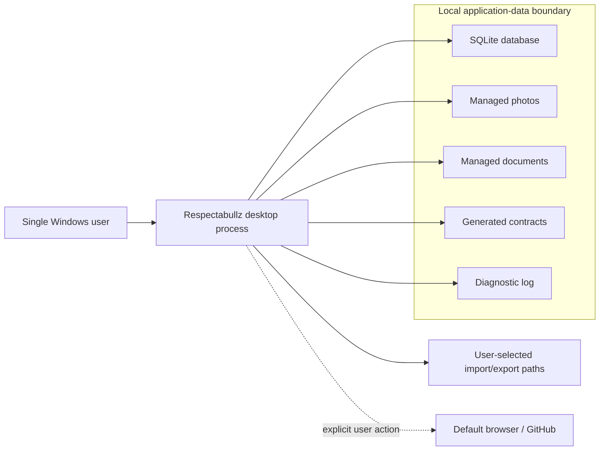
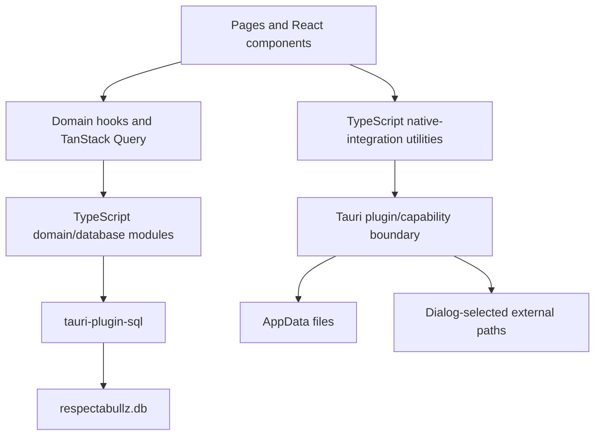
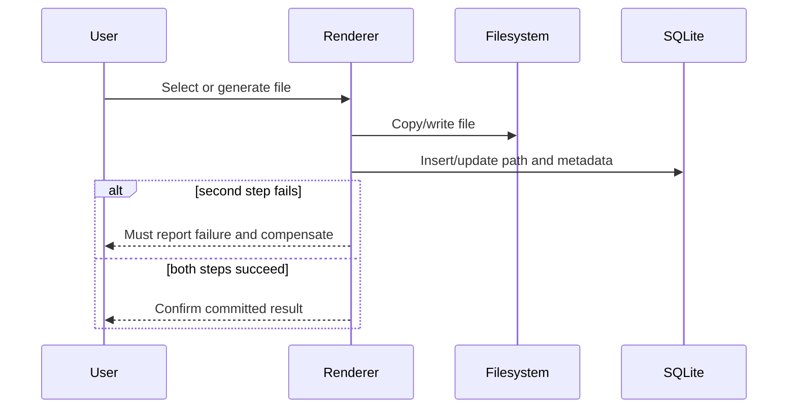

# Respectabullz Architecture

Last reviewed: 2026-07-14 against commit
`fd21363beae044f0649a1e03f3bb6bcc2249f970`

## Accurate technical description

Respectabullz is a React and TypeScript desktop application packaged with Tauri 2.
It uses SQLite through `tauri-plugin-sql`, scoped filesystem/dialog/notification
plugins, and narrow Rust commands for database integrity, managed documents, and the
fixed support-page destination. The broad shell plugin/permission is not enabled.

Most domain/UI logic remains in TypeScript, while the Rust crate now owns the Tauri
host plus integrity-sensitive setup/migration and managed-document boundaries. It is
not a separate API server. Prisma files are development/schema reference material;
Prisma is not the runtime ORM.

## System context

Core workflows do not require an application backend. Browser, cloud-folder, and
export destinations are external boundaries. Opening or copying content to them is
not the same as keeping data inside the local application boundary.

## Runtime components

### React renderer

`src/` contains the user interface, form logic, domain hooks, database modules, and
native-integration utilities. React Hook Form and Zod are used in selected forms and
boundaries; this does not prove that every input or imported file is schema-validated.

TanStack Query manages fetched state, caching, invalidation, and optimistic updates.
Optimistic behavior must be tested per mutation because a cache rollback does not
roll back a database or filesystem side effect.

### Database access

Tauri's SQL plugin preloads only `sqlite:respectabullz.db` from trusted application
configuration. `src/lib/db/connection.ts` retrieves that existing pool with
`Database.get`; production and synthetic-demo capabilities grant select/execute but
not renderer-controlled pool load/close. This prevents alternate SQLite pool creation
through the renderer but is not a query sandbox: renderer code still issues hand-written
parameterized SQL against the fixed application database. Domain modules cover animals,
litters, health, breeding, clients, sales, operations, documents, settings, and
dashboard queries.

Fresh setup and the declared schema-v4→v5 migration are owned by the typed Tauri
command in `src-tauri/src/database_integrity.rs`. It acquires one SQLx connection,
sets a per-connection busy timeout, starts `BEGIN IMMEDIATE`, enables and verifies
foreign keys, runs setup/migration and schema-version update, checks required tables
and `foreign_key_check`, and commits or rolls back. `src/lib/db/schema.sql` is embedded
for schema setup. Other historical schema versions are explicitly unsupported.

The former automatic `respectabullz_db` browser-storage importer is also unsupported.
Startup performs a read-only key check before SQLite setup; detection, or inability to
inspect browser storage, blocks the operational shell and leaves the payload untouched.
This is containment, not a recovery feature.

Seven real-SQLite tests cover fresh setup, v4→v5, a no-op second run, two-connection
startup serialization, injected-failure rollback and retry, unsupported baseline
rejection, and a foreign-key violation. Final packaged Windows upgrade verification is
still pending. This scoped migration result does not prove global application
foreign-key enforcement.

The application shell is not rendered until database integrity setup and document
reconciliation return successfully. A setup/reconciliation failure shows a blocking
retry screen instead of operational routes. Reconciliation takes the same
`BEGIN IMMEDIATE` write reservation used by document mutations. Its 10,000-entry scan
limit can produce a warning and allow startup only when no actual failure was recorded;
such a result is truncated rather than exhaustive.

`prisma/schema.prisma` and other schema descriptions are reference material and may
drift; they must not be presented as the runtime source of truth. See
[Reliability](RELIABILITY.md).

### Tauri host and plugins

`src-tauri/` configures the desktop window and registers plugins. Renderer-visible
capabilities control access to native filesystem, dialog, notification, and SQL
operations. Broad Tauri shell-open permission and plugin initialization were removed;
managed documents open through a Rust command that requires a database-backed filename
and canonical path inside the managed directory. A configured permission or CSP is a
boundary, not proof that every native call is safe.

The CSP permits inline styles and image loading from self, data/asset sources, and
`http://asset.localhost`, which Tauri's `convertFileSrc` uses for scoped local assets.
Connection sources remain self-only. Permission and asset-origin scope remain part of
the remediation threat model.

## Storage model

Tauri's application-data directory contains or can contain:

- `respectabullz.db` — SQLite records;
- `photos/` — application-managed animal/litter images;
- `documents/` — copied application-managed documents;
- `contracts/` — contracts saved to the default managed location; and
- `logs/respectabullz.log` — local diagnostics.

Some settings allow a user-selected external contract or export destination. Those
files are outside the managed storage boundary. SQLite generally stores paths or
filenames for associated files rather than their binary contents.

The database, managed files, logs, and current exports are plaintext unless the host
or destination supplies encryption.

## Data flows

### Read

1. A page calls a domain hook.
2. The hook calls a TypeScript database function.
3. The function sends a parameterized query through `tauri-plugin-sql`.
4. Returned rows are mapped to TypeScript objects.
5. TanStack Query caches the result and React renders it.

### Database-only write

1. A form or action validates the fields covered by that UI boundary.
2. A mutation calls a domain database function.
3. SQL changes the relevant rows.
4. Query data is invalidated or an optimistic cache is reconciled.
5. The UI reports the result.

Each path still needs negative tests for constraint failures, malformed state, and
query/cache reconciliation.

### Database plus file write

Document, photo, contract, and export workflows cross two independent systems:
SQLite and the filesystem. There is no shared transaction between them.

The managed-document path now provides scoped compensation: file selection does not
write permanent storage; one Rust command validates and stages the file while one SQLx
connection/transaction creates the document, tags, and entity link; edit replaces
notes/tags in one transaction; and delete uses a recoverable tombstone. Startup
reconciliation removes abandoned staging, restores or removes tombstones according to
database state, and quarantines unregistered final files. A commit-result ambiguity on
delete preserves the tombstone for that durable-state decision instead of guessing.
Actual reconciliation failures block startup; scan-limit truncation warns and permits
startup only when no failure was recorded, so the scan is not represented as exhaustive.

This does not make SQLite and the filesystem one atomic system. File cleanup can still
leave an explicitly reported residue, and photo, contract, export, and other file
workflows retain their own narrower guarantees. Individual write-to-temp/rename helpers
reduce interrupted-write risk only for their documented destination.

The partial ZIP exporter is an explicit exception: the native save grant covers the
exact selected file, not a sibling temporary path, so the exporter writes directly and
is non-atomic. Custom contract-folder grants are session-scoped and must be reselected
after restart; persisted legacy paths are ignored by generation.

## Recovery boundary

The historical restore path is withdrawn. It could write photos before database
import succeeded, and the export did not cover all application state. Existing JSON
and ZIP outputs are therefore partial exports, not verified backups.

The proposed staged format and acceptance matrix are in
[`BACKUP_FORMAT.md`](BACKUP_FORMAT.md). No format version is currently supported for
restore.

There is also no verified in-app factory reset. A complete reset requires enumerating
every database table and managed file category, handling failures, and distinguishing
managed data from external copies.

## Network and reporting boundary

Core operation has no application server. The historical code path for direct GitHub
issue creation with a Vite-bundled token is unsupported and must not be configured.
The portfolio-safe reporting design is:

1. prepare sanitized report text locally;
2. show the exact content to the user;
3. after explicit approval, copy that exact text and open only the fixed blank GitHub
   Issues/new page, with no report data in the URL; and
4. require the user to paste and submit it under their own GitHub session.

The preview remains the final semantic privacy check. Never place a repository token
or configurable support destination in renderer-visible configuration.

## Trust boundaries and assumptions

The architecture trusts:

- the signed-in Windows user to control local access;
- the operating system and Tauri runtime;
- installed npm and Rust dependencies;
- SQLite and filesystem behavior within their documented contracts; and
- users to review content before external submission or export.

It does not defend against an attacker who already controls the Windows account or
device. It must still defend against malformed imported files, path manipulation,
resource exhaustion, partial failure, stale/corrupt databases, accidental destructive
actions, and renderer compromise within the granted capabilities.

See the [threat model](THREAT_MODEL.md) and [privacy statement](../PRIVACY.md).

## Deployment boundary

The configured Windows bundle target is NSIS. A local `tauri build` output is not a
verified public release. Distribution requires a controlled build, dated test and
advisory evidence, a SHA-256 checksum, an SBOM where practical, explicit signing
status, and a clean-machine smoke test for the exact tag and commit.

The repository defines a required frontend/Windows/security-evidence CI workflow, but
no successful final-SHA public run is linked yet. No current document claims a signed
or clean-machine-verified installer.

## Deliberate exclusions

- cloud synchronization;
- browser or mobile clients;
- multi-user permissions;
- application-level authentication;
- hosted API services;
- encrypted fields or encrypted backup archives; and
- model inference, retrieval, or other AI runtime features.

## Architecture decisions

- [ADR 0001: Local-first Windows desktop](adr/0001-local-first-desktop.md)
- [ADR 0002: Withdraw unsafe restore](adr/0002-withdraw-unsafe-restore.md)

Future architectural claims must link to implemented code and dated evidence. This
document should be revised whenever storage, permissions, external connections,
migration support, or release boundaries change.
