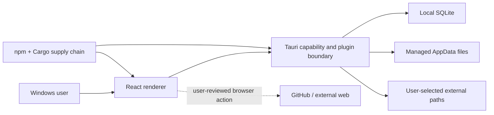

# Threat Model

Last reviewed: 2026-08-22

## Scope

This threat model covers the single-user Windows desktop application, its React/Tauri
process, local SQLite database, managed files, imports/exports, diagnostics, and
release artifacts. It is a self-review and does not represent an independent security
assessment.

## Assets

- breeder and client contact information;
- animal identity, health, genetic, pedigree, and breeding records;
- sales, deposits, expenses, and transport details;
- photos, contracts, uploaded documents, and generated packets;
- application settings and local diagnostic logs;
- source/build integrity and any future signing identity; and
- user trust in destructive, export, and recovery messages.

## Trust boundaries

Crossing into an external path, browser, cloud-synchronized folder, removable drive,
or uploaded issue leaves the application-managed local boundary.

## Assumptions and non-goals

The application assumes the Windows user and operating system are not already fully
compromised. It does not provide application login, multi-user isolation, field-level
encryption, cloud authorization, or protection from an attacker who controls the
Windows account.

It still needs to handle untrusted files, malformed databases/archives, path input,
dependency compromise, accidental destructive actions, partial failure, and renderer
compromise within granted capabilities.

## Threats and required controls

| Threat | Impact | Current posture | Required evidence/control |
| --- | --- | --- | --- |
| Renderer-side credential exposure | Repository compromise | Historical Vite-bundled PAT design is unsupported | No credential inputs or authorization header in renderer/build; secret and artifact scan |
| Renderer compromise using capabilities | Read/write/open beyond intent | Renderer SQL plugin permissions are removed; one native command boundary rejects schema, transaction, extension, filesystem, stacked, and unsupported SQL. Filesystem access is deny-by-default and limited to direct files in four managed directories; asset URLs expose direct photo files only. Dedicated Rust transactions own multi-row sales | Keep moving domain/file operations behind purpose-specific native commands; retain negative SQL, path, permission, and navigation tests |
| Partial restore mutates files | Data inconsistency/loss | Restore withdrawn | Staged format, full validation, pre-restore snapshot, rollback/failpoint matrix |
| Partial legacy browser-storage conversion | Split or duplicated records and source-data loss | Non-transactional importer and automatic cleanup removed; read-only detection blocks before SQLite setup and preserves the payload | Versioned transactional importer, full mapping/validation, rollback/retry matrix, and explicit source-retention policy before reinstatement |
| Incomplete reset reports success | Privacy and trust failure | No verified factory reset | Table/file inventory, transaction, residual enumeration, precise result summary |
| Database/filesystem split-brain | Orphans or broken references | Managed documents use staged files, recoverable tombstones/quarantine, `BEGIN IMMEDIATE` serialization, startup reconciliation, and focused Rust tests. Photo cleanup is record-first, reports failures, and excludes orphans from export, but a failed deletion can leave a file | Extend native state machines and injected-failure tests to every database/file workflow |
| Bounded reconciliation misses later residue | Uninspected orphan/tombstone remains | Actual failures block operational routes, but the 10,000-entry scan limit warns and permits startup with an explicitly truncated result | Operational continuation/full-scan tooling, residue metrics, and limit-exhaustion tests before claiming exhaustive cleanup |
| Interrupted or incomplete partial ZIP export | Incomplete file mistaken for recovery | ZIP writes directly to the exact dialog-granted target and is explicitly non-atomic/non-recoverable; managed-photo enumeration/read failures abort before the save dialog instead of silently omitting files | Clear partial-export labeling, visible write failure, independent backups, and future staged recovery format |
| Malicious ZIP/archive | Traversal, overwrite, decompression exhaustion | No complete adversarial matrix | Canonical paths, entry/size/count limits, duplicate rejection, staged extraction |
| Malformed image/PDF/Office file | Parser exploit or resource exhaustion | Photo intake/export enforces strict names, signatures, dimensions, full-canvas work for every animation frame, per-file/aggregate sizes, and counts; packet PDF embedding is capped at 8 MiB each, 25 photos, and 48 MiB total. Document intake enforces 100 MiB. Inline preview is PDF-only, signature-checked, and capped at 20 MiB; legacy image documents are delegated to the system viewer. This is not parser-safety proof | Page/decompression/time limits, maintained parsers, system-viewer patching, and broader adversarial fixtures |
| Path manipulation or stale grant | Access outside managed/dialog-selected scope | Managed-document selection is dialog-scoped, canonical opens are database-backed, filenames are revalidated before preview, and native managed roots reject links/reparse points. Capabilities allow direct children only | Keep canonicalization, allowlisted roots/extensions, reparse handling, and negative tests on every file workflow |
| Sensitive log/report disclosure | Personal data leaves device | Central rules redact common sensitive keys/values and truncate output; log clear/export serialize with pending writes; semantic PII can remain | Default minimization, preview, focused redaction/ordering tests, explicit consent, retention controls |
| Plaintext local storage | Disclosure after local/device access | Database/files/exports are plaintext | Document limitation; recommend OS/storage encryption; future encryption design if required |
| Dependency compromise/advisory | Code execution or data access | The dated complete npm graph has zero findings. Rust policy has no unignored vulnerability entries and one documented non-compiled SQLx MySQL/RSA exception; informational warnings remain in the [risk ledger](case-study/DEPENDENCY_RISK.md) | Locked installs, exact feature/target triage, required scans, npm/Rust SBOMs, controlled framework upgrades |
| Unsigned or substituted installer | Publisher impersonation/malware delivery | CI does not upload an unsigned installer. The exact-version-tag release workflow requires a protected PFX, complete test/audit gates, timestamp, certificate match, valid signatures, checksums, SBOMs, and artifact scanning before upload; no successful signed run is yet retained | Configure protected signing inputs, retain exact-run evidence, and publish only verified release-workflow output |
| Stale documentation | Unsafe user action and false assurance | High-risk public manuals corrected; legacy reports archived with obsolete banners | Keep claim-to-evidence review and link checks in the change gate |

## Existing defensive signals

The repository includes:

- a configured CSP;
- Tauri capabilities with deny-by-default, direct-child managed-file scopes;
- a Rust-mediated, fixed-pool SQL boundary and purpose-specific sale transactions;
- parameterized SQL in database modules;
- selected path and filename validation;
- validated UUID-based managed filenames and native reparse-point checks;
- structured local logging; and
- an operational-shell startup gate with retry on actual database-integrity or
  document-reconciliation failures; and
- write-to-temp/rename helpers for selected file writes.

These are useful controls, not comprehensive guarantees. Their coverage, scope, and
failure behavior must be verified per boundary.

## Privacy abuse cases

- A screenshot includes a real client name or Windows username.
- A bug report includes a token, stack trace, path, or record content.
- A clear/reset message causes a user to discard other copies while residual local
  files remain.
- A partial export is called a backup, leading to unrecoverable records.
- A contract or export saved to a synchronized folder is assumed to remain local.
- A developer runs the standard seed against an important empty database or mistakes
  fixture records for customer evidence.

The controls are synthetic demo data, user-visible previews, precise scope language,
the separate `com.respectabullz.demo` application-data and capability boundary,
explicit external-boundary notices, and verified residual enumeration. The seed still
has no automated teardown and refuses existing user-created records rather than deleting data.

## Security test corpus

Security-sensitive tests should include:

- `..`, rooted, alternate-separator, reserved-device, long-path, Unicode-normalization,
  symlink, junction, and reparse-point paths;
- duplicate/case-colliding ZIP entries, zip bombs, huge entry counts, invalid CRC,
  truncated archives, and nested archives;
- oversized/decompression-heavy images, invalid PDFs/Office files, and extension/
  content mismatches;
- locked, read-only, missing, low-space, and permission-denied destinations;
- database corruption, foreign-key violations, version mismatch, interruption, and
  retry; and
- report/log payloads containing emails, phone numbers, Windows paths, access tokens,
  and record fragments.

## Release and review cadence

Revisit this model whenever permissions, CSP, storage, imports, exports, logging,
reporting, migrations, recovery, or release automation changes. A release summary
should link to the exact commit, dated scans, accepted-risk decisions, and tests for
affected threats.

Related documents: [Security](../SECURITY.md), [Privacy](../PRIVACY.md),
[Reliability](RELIABILITY.md), and [Test evidence](case-study/TEST_EVIDENCE.md).
