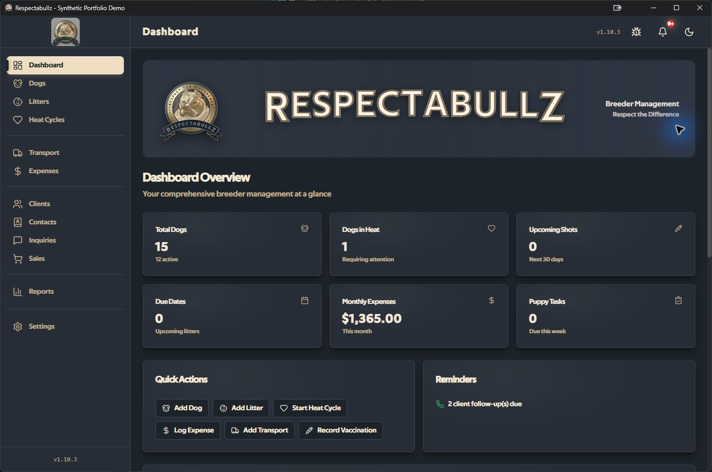

# Respectabullz Case Study

Status: **Local remediation gates complete; public CI and signed release pending**
Source version: **1.10.4**
Historical evidence baseline: commit `fd21363beae044f0649a1e03f3bb6bcc2249f970`,
2026-07-14

## Product ownership

### Problem

Dog-breeding operations can fragment across spreadsheets, paper health records,
photos, contracts, messages, payment notes, and reminders. That fragmentation makes
relationships and follow-up work difficult to see: an animal connects to lineage,
health, breeding events, a litter, inquiries, a placement, documents, and financial
records.

Respectabullz explores a single local system of record that connects those workflows
and generates the files operators already exchange.

### Intended user

The intended user is a single Windows-based breeder/operator who values offline
access and local file ownership. No measured customer adoption, production usage, or
business outcome is claimed.

### Constraints

- Records can contain sensitive contact, health, genetic, and financial information.
- Connectivity may be intermittent or deliberately avoided.
- The workflow is document- and photo-heavy.
- SQLite and the filesystem do not share one transaction.
- Windows permissions, packaging, file locks, paths, and SmartScreen behavior matter.
- A public portfolio needs synthetic data and rights-reviewed assets.

### Product scope

The repository models:

- animals, pedigree, genetics, health, breeding, litters, and puppies;
- inquiries, waitlist, clients, sales, deposits, and transport;
- contacts, communication history, reminders, and dashboard summaries;
- expenses and operational reports; and
- uploaded documents, contracts, customer packets, photos, and exports.

The deliberate exclusions are cloud synchronization, mobile, multi-user
authorization, hosted billing, application accounts, and AI model features.

### Role and ownership boundary

LeftHandVoodoo owns the repository and presents it as AI-assisted product engineering.
The portfolio narrative covers product definition, workflow modeling, architecture,
implementation, debugging, verification, packaging, and remediation only to the
extent the owner can personally explain and demonstrate those activities.

AI usage and the verification standard are disclosed in
[AI-assisted engineering](AI_ASSISTED_ENGINEERING.md).

### Synthetic application evidence

The following application screenshots were captured from the live Windows/Tauri
development build on 2026-07-14 after the containment controls and deterministic
fixture were verified. The build used the separate `com.respectabullz.demo` identity;
the isolated local profile was removed after capture. The records use reserved `.test`
email addresses, reserved `202-555-01xx` phone numbers, and `DEMO-*` identifiers. They
are not customer data or evidence of adoption.

| Visual | Required synthetic state | Status |
| --- | --- | --- |
| Dashboard | Upcoming tasks and high-level operations | Captured from live synthetic demo |
| Dog records | Fictional animals with reserved registration identifiers | [Captured](screenshots/dogs-overview.jpg) |
| Litter workflow | Breeding/birth/puppy state and tasks | [Captured](screenshots/litters-workflow.jpg) |
| Inquiry to sale | Fictional inquiry, client, placement, and payment state | [Inquiry](screenshots/inquiries-pipeline.jpg) and [sales](screenshots/sales-overview.jpg) captured |
| Document generation | Fictional contract/packet preview | [Verified synthetic packet](synthetic-customer-packet.pdf) and [preview](screenshots/customer-packet-preview.png) |
| Architecture | Current trust boundaries and external paths | Mermaid source plus the trust-boundary graphic on Slide 4 of the [employer deck](Respectabullz_Employer_Case_Study.pptx) |
| Quality evidence | Dated CI result for final SHA | Required workflow present; successful final-SHA run pending |

The containment screen is also preserved as
[UI evidence](screenshots/settings-containment.jpg): restore and factory reset are
unavailable, and the remaining JSON/ZIP controls describe their output as partial.

Five byte-identical Python `SyntaxError` images found in the legacy
`image/README/` directory were removed during cleanup; they were not product
screenshots.

## Engineering judgment

### Current architecture

React and TypeScript implement the renderer, forms, hooks, and most domain logic. Rust
owns the one supported SQLite pool. Renderer database helpers cross bounded native
read/mutation commands; schema/transaction control and protected sale tables are not
available through that generic path. Purpose-specific native commands own database
initialization/migration, sale lifecycle transactions, managed-document coordination,
safe path/link handling, and the fixed support-page destination. Filesystem capability
is deny-by-default and operation-specific for direct managed files. There is no native
notification integration in v1.10.4. The Rust crate remains a desktop boundary rather
than a separate service layer.

Core operation has no hosted backend. SQLite, managed photos/documents/contracts, and
logs live on the local device; user-selected exports and browser actions cross the
application boundary. See [Architecture](../ARCHITECTURE.md).

### Reliability deep dive: recovery claim correction

The most important engineering finding was not a missing feature. It was a mismatch
between the word “restore” and the behavior the code could guarantee.

The historical ZIP path could write photos before database import completed. The
database import path did not complete successfully, the archive omitted managed data
categories, and there was no versioned compatibility, staging, rollback, or
interruption contract. A failed operation could therefore change live files without
recovering the database.

The containment decision is to withdraw restore, describe existing outputs as partial
exports, and keep recovery out of the demo. The proposed replacement validates into a
staging area, checks a complete manifest and hashes, verifies SQLite integrity and
foreign keys, creates a pre-restore snapshot, switches state through a Windows-safe
protocol, and rolls back on every failpoint. That proposal is documented—but not
implemented—in [BACKUP_FORMAT.md](../BACKUP_FORMAT.md).

### Migration and cross-boundary integrity

Review found that the original migration sequence did not own one connection-level
transaction. The remediation now routes fresh setup and the declared schema-v4→v5
upgrade through one Rust/SQLx transaction, explicitly checks foreign keys, rejects
unsupported baselines, and has real SQLite tests for success, rollback/retry, and
drift. Final packaged Windows upgrade verification remains pending, and this does not
establish global FK enforcement for later pooled connections.

The managed-document path now keeps selection side-effect-free, validates size and
supported signatures, stages file creation, groups metadata/tags/entity links on one
SQLx transaction, uses recoverable delete tombstones, and reconciles staging,
tombstones, registered files, and quarantined orphans at startup. Managed opens resolve
only the canonical database-backed file. Reconciliation serializes with document
writes using `BEGIN IMMEDIATE`; ambiguous delete commits retain a tombstone for durable
startup resolution. Operational routes remain behind a blocking retry screen on
actual setup/reconciliation failure. A 10,000-entry scan-limit warning can allow
startup when no failure was recorded, so reconciliation is bounded, not exhaustive.
Focused Rust tests exercise success and recovery/failure paths. This is a scoped
correction, not a blanket “atomic writes” claim for every photo, contract, export, or
other database/filesystem workflow. See [Reliability](../RELIABILITY.md).

The development-only synthetic fixture follows the same claim discipline. The
frontend collects only allowlisted inserts, while a Rust command rejects release
builds, acquires one SQLite connection, starts `BEGIN IMMEDIATE`, rechecks that all
application tables are empty under the write lock, applies the fixture, verifies
foreign keys, and commits or rolls back. A live isolated run populated the fixture and
rendered the screenshots above; duplicate-key failure is covered by a rollback test.

### Performance and product-shape decision

The frontend uses page-level lazy loading and Vite manual chunks for large chart and
PDF dependencies. That is a reasonable response to a feature-rich desktop bundle,
but historical percentage-reduction claims are not reused without a reproducible
before/after measurement for the displayed commit.

### Quality evidence

The dated local baseline passed ESLint, TypeScript, and 290 Vitest tests. Configured
coverage reported 10.93% statements/lines and exposed 0% coverage in critical
migration and document paths. The coverage configuration itself includes a test file
in measured source. The remediation configuration excludes test/setup sources and
enforces initial statement/branch/function/line floors; the later v1.10.3 scoped run
passed.

Dependency scans reported unresolved advisories. No required public CI, Windows
packaged smoke test, checksum, SBOM, or signing evidence existed at the baseline.

The later **historical v1.10.3** local pre-release checkpoint passed 354 frontend tests
in 39 files and 39 Rust tests. Its exact tree also passed lint/type/version/demo guards,
build/scanning, dependency, workflow-lint, and npm-SBOM checks. A native smoke exposed
a startup panic; after correction, the rebuilt executable stayed alive for eight
seconds with empty stderr. That launch was not isolated from the real profile, so it is
historical engineering evidence rather than a current packaged-release claim.

The historical v1.10.3 local NSIS build was 29,413,927 bytes with SHA-256
`3167be8a9a0b774a72bcc4b1af30fd00ac95e03215c4bc6dd4d79d74b020bd11`.
It and the release executable were unsigned. An 84-file artifact scan found no
configured token markers, and a local npm CycloneDX SBOM recorded 700 components.
Those artifacts are pre-release evidence, not a published signed release.

That historical coverage checkpoint met the configured initial floors at 22.21%
statements/lines, 62.73% branches, and 27.85% functions. Broad statement/line coverage
remains low; focused tests on the new critical paths are the more specific evidence.

The v1.10.4 remediation adds the bounded database command layer, typed transactional
sale workflows, operation-specific native file scope, validated referenced-photo
handling, and signed-only release automation. The pinned local gate passed 439
frontend tests in 50 files, 68 Rust tests, lint/type/coverage/Clippy checks, workflow
lint, web build, and the Windows release-profile `--no-bundle` build. Vitest 4/V8
measured 26.40% statements, 20.06% branches, 17.52% functions, and 27.74% lines. The
complete npm graph has zero advisories. Rust policy has no unignored vulnerability
entry, one documented exception for the unselected SQLx MySQL/RSA path, and 20
informational warnings that remain tracked.

Ordinary CI requires database-initialization/reconciliation readiness from an ephemeral
unsigned executable but uploads evidence only. Distribution requires a successful
exact-version-tag protected release run that repeats all gates, verifies timestamped
signatures, scans the artifacts, and retains checksums plus npm/Rust SBOMs.
No successful public final-SHA CI or signing run is yet claimed.

Exact commands and limitations are in [TEST_EVIDENCE.md](TEST_EVIDENCE.md). The test
count is not used as the headline proof.

### Security and privacy

Positive signals include a CSP with a scoped local asset origin, Tauri capabilities,
parameterized SQL in many paths, selected filename/path checks, and local storage.
Residual risk remains substantial:

- historical renderer-side GitHub credential design and external rotation evidence that
  cannot be proven from this repository;
- a bounded generic renderer database command surface that is not per-record
  authorization;
- operation-specific native file authority within direct managed-file scopes;
- plaintext local data, logs, and exports;
- incomplete archive/media/document adversarial testing;
- semantic sensitive logging/reporting content that can fall outside the tested
  key/value redaction rules;
- one documented RustSec exception for the unselected SQLx MySQL/RSA path plus
  informational Rust warnings (npm advisories 0; see the
  [dependency risk ledger](DEPENDENCY_RISK.md)); and
- no successful protected signed-release run or independently verified Windows release.

The project distinguishes self-review and automated scanning from independent
assessment. See [Security](../../SECURITY.md), [Privacy](../../PRIVACY.md), and
[Threat model](../THREAT_MODEL.md).

### Mistake and correction

The repository previously accumulated broad claims—full restore, complete deletion,
all critical writes atomic, all security findings resolved, and fixed test totals—that
were not supported by one reproducible evidence chain.

The correction is to preserve the finding, narrow the claims, withdraw unsafe
features, publish dated commands and gaps, and require every demo/deck metric to name
its source, date, commit, and definition. This is a stronger portfolio story than
presenting the original state as already production-ready.

### Next three improvements

1. Complete final v1.10.4 validation for a frozen commit, including frontend/Rust
   counts, coverage, dependency policy, secret scans, workflow lint, and the Windows
   `--no-bundle` build.
2. Run the required public CI and protected signed-release workflows, retain their
   evidence, and smoke/upgrade-test the verified signed installer on a clean Windows
   profile. Rotate any historically exposed external credential outside the repository.
3. Recapture supported demo workflows under the dedicated
   `com.respectabullz.demo` development identity, then publish the synthetic assets and
   failure evidence from one frozen commit.

## Employer relevance

Respectabullz is supporting evidence for:

- product engineering and domain modeling;
- desktop/native workflow integration;
- automation and solutions work involving structured state and documents;
- QA/evaluation through invariants, adversarial cases, and evidence calibration; and
- AI-assisted engineering with explicit human ownership.

It is not presented as an AI application, cloud-scale system, independently audited
security product, or production-proven platform. A separate applied-AI project should
demonstrate model integration, grounding, evaluation, latency, cost, and human review.

## Readiness gate

This case study is not recruiter-ready until final v1.10.4 validation, public CI,
protected signing, and clean-machine evidence pass for the displayed SHA; synthetic
assets remain rights-reviewed historical captures until README/screenshots/demo/deck
are refreshed together.
